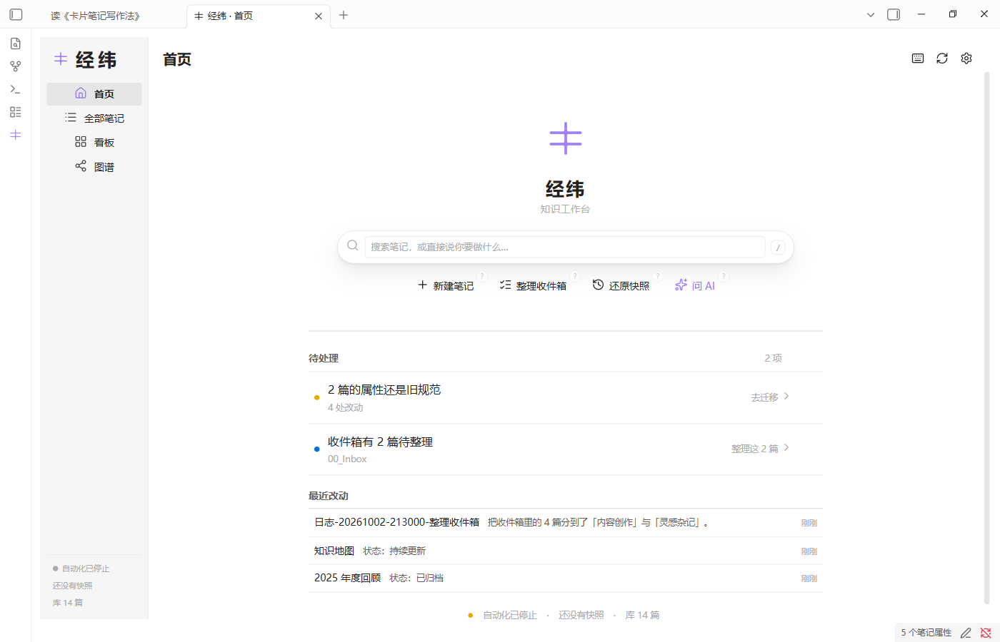

# 经纬 · 知识工作台

**让知识，有下一步。**

面向 Obsidian 的知识工作台，集笔记管理、办公整理、AI 助手与学习回顾于一体。

2026 华为智创杯 AI 应用创新大赛参赛作品 · **特别厉害的队**



## 主要功能

- **办公整理**：首页模块排布、全部笔记、多选批量处理、待处理提醒与看板。
- **AI 助手**：自然语言对话、知识库检索与文档操作，写入前确认。
- **学习回顾**：知识卡生成、编辑与间隔复习。
- **快照还原**：重要写操作提供快照、撤销和还原。

## 构建与安装

环境：Node.js 24、Obsidian 1.13.0+。

```bash
npm ci
npm run build
```

将 `main.js`、`manifest.json`、`styles.css` 和 `assets/` 复制到知识库的 `.obsidian/plugins/kb-workbench/`，在 Obsidian 社区插件设置中启用「经纬」。AI 服务地址、模型与 API key 在插件中自行配置。

## 相关文档

- [参赛设计文档](参赛-设计文档.md) · [效果佐证](参赛-效果佐证.md)
- [开发指南](docs/开发指南.md) · [文档目录](docs/README.md)
- [更新日志](CHANGELOG.md)
